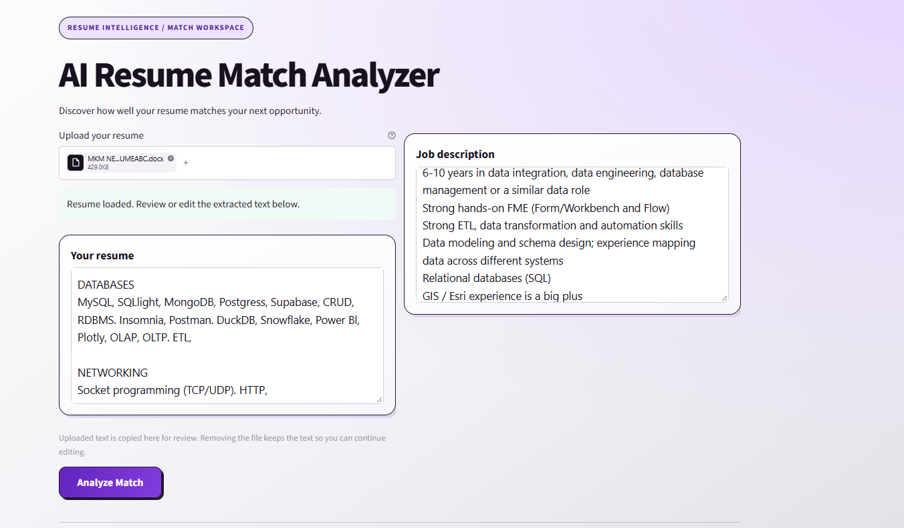
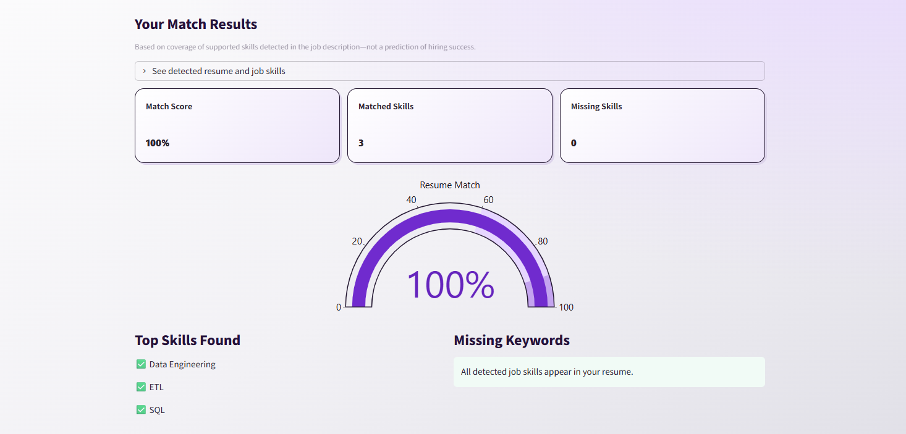

# AI Resume Match Analyzer

A polished, interactive resume-to-job comparison dashboard built with Python and
Streamlit. Paste your resume or upload a document, compare it with a job
description, and turn keyword gaps into an actionable improvement plan.

**Transparent by design:** this version uses rule-based keyword matching and
lightweight NLP text normalization, not an LLM or a trained AI model. No API key
or paid AI service is required. Scores measure supported skill coverage, not
hiring likelihood or compatibility with every applicant tracking system.

## Before and after analysis

**Before:** Review the uploaded resume text and enter the job description, then
select **Analyze Match**.



**After:** The existing results preview shows all three detected skills matched
and no missing keywords. It uses no personal resume text.



The dashboard also includes the comparison chart, Resume Health card, and
improvement plan described below. For more detail, see [Using the app](#using-the-app).

## Features

- **Flexible inputs:** paste full resume text or drag and drop PDF, Word
  (`.docx`), and UTF-8 text (`.txt`) files up to 5 MB.
- **Editable extraction:** review and correct uploaded text before analysis.
- **Match score:** percentage of distinct detected job skills found in the resume.
- **Explainable results:** inspect detected resume skills, job skills, matches,
  and missing keywords.
- **Interactive charts:** Plotly match gauge and matched-versus-missing bar chart.
- **Resume Health card:** color-coded alignment bands with an explicit scoring
  explanation.
- **Improvement plan:** skill-gap recommendations and a check for quantified
  impact, with reminders never to invent experience.
- **Premium interface:** white and purple colors, black trim, soft gray
  gradients, readable typography, responsive columns, hover effects, and metric
  entrance animations that respect reduced-motion preferences.
- **Automated tests:** document parsing, skill detection, health thresholds,
  recommendations, and rendered chart data.

## How scoring works

```text
Match score = round(matched distinct job skills / detected distinct job skills * 100)
```

For example:

```text
Resume:          Python, SQL, Excel
Job description: Python, SQL, AWS, Airflow

Matched: Python, SQL
Missing: AWS, Airflow
Score:   2 / 4 = 50%
```

Repeated keywords do not earn extra points. Skills present only in the resume
do not increase the score. If the job description contains no supported skills,
the app explains this instead of displaying a misleading score.

### Supported skills

Python, SQL, Snowflake, ETL, Power BI, AWS, Azure, Data Engineering, Machine
Learning, Analytics, Airflow, Spark, Excel, Tableau, Pandas, Docker, and Git.

Matching ignores capitalization, normalizes whitespace and invisible formatting
characters, and recognizes "Data Engineer" and "Data Engineers" as
"Data Engineering". Whole-word boundaries prevent SQL from matching inside
MySQL. This is intentionally a small, inspectable vocabulary, not comprehensive
semantic analysis.

### Resume Health bands

| Match score | Alignment rating |
| --- | --- |
| 90-100 | Excellent |
| 75-89 | Good |
| 60-74 | Fair |
| Below 60 | Needs Improvement |

Resume Health uses the same match score; it is not an independent assessment of
resume quality, factual accuracy, formatting, or hiring readiness.

## Technologies

| Technology | Purpose |
| --- | --- |
| Python | Application and analysis logic |
| Streamlit | Interactive dashboard and file uploads |
| Pandas | Skills comparison dataset |
| Plotly | Match gauge and bar chart |
| pypdf | Text-based PDF extraction |
| python-docx | Word paragraph and table extraction |
| Regular expressions / Unicode normalization | Rule-based skill detection |
| unittest / Streamlit AppTest | Unit and dashboard regression tests |

NLTK is not required by this version.

## Installation: Windows and VS Code

Tested with **Python 3.14.3**. Git and Python must be available in your terminal.

### 1. Clone the repository

```powershell
git clone https://github.com/MaxKarltun/AI-Resume-Match-Analyzer.git
cd AI-Resume-Match-Analyzer
```

If you already cloned it, open that project folder instead.

### 2. Create a virtual environment

```powershell
python -m venv .venv
```

### 3. Install dependencies

```powershell
.\.venv\Scripts\python.exe -m pip install -r requirements.txt
```

### 4. Start the dashboard

```powershell
.\.venv\Scripts\python.exe -m streamlit run app.py
```

Open the local URL printed in your terminal, usually `http://localhost:8501`.
Keep the terminal running. Press **Ctrl + C** to stop the app.

These commands explicitly use the project environment, so activation and
PowerShell execution-policy changes are unnecessary. Run them from the project
root so Streamlit loads the theme configuration.

## Using the app

1. Paste your resume, or drop a supported file into **Upload your resume**.
2. Review the extracted text. Correct extraction issues directly in the editor.
3. Paste the complete job description into the second text box.
4. Click **Analyze Match**.
5. Review the score, charts, missing keywords, and improvement plan.
6. Expand **See detected resume and job skills** to understand the result.

After editing a resume file on your computer, save and upload the new copy.
An existing upload does not automatically sync with local edits. Removing a
file keeps its extracted text in the editor. Editing inputs clears the previous
results until you analyze again.

## Document limitations and privacy

- Scanned/image-only documents need OCR before upload; OCR is not included.
- Password-protected PDFs are not supported.
- Word body paragraphs and tables are extracted; text boxes, images, headers,
  and footers may not be captured.
- PDF reading order can vary with document layout. Always review extracted text.
- Text uploads must use UTF-8 encoding.
- Keyword matching does not understand context, negation, proficiency, or years
  of experience. A keyword appearing in text is not proof of competency.
- The impact check looks for numbers paired with units such as percentages,
  records, time, or dollar amounts. It does not verify the truth of a claim.
- Uploaded documents are processed by the Streamlit server without an external
  AI or document-processing API. The application does not deliberately save
  resumes to disk. Run locally for private documents, omit unnecessary personal
  details, and do not upload sensitive information to untrusted deployments.
- Private uploads, virtual environments, caches, and Streamlit secrets should
  never be committed. The repository includes corresponding ignore rules.

## Run tests

From the project root:

```powershell
.\.venv\Scripts\python.exe -m unittest discover -s tests -v
```

Tests generate synthetic documents in memory; no personal resume is needed.

## Project structure

```text
AI-Resume-Match-Analyzer/
|-- app.py
|-- resume_analysis.py
|-- resume_parser.py
|-- requirements.txt
|-- README.md
|-- .gitignore
|-- .streamlit/
|   `-- config.toml
|-- screenshots/
|   `-- dashboard.png
`-- tests/
    |-- test_resume_analysis.py
    |-- test_resume_parser.py
    `-- test_skill_matching.py
```

## Future enhancements

- Semantic matching with embeddings and evidence-linked explanations.
- A broader skill vocabulary with carefully tested aliases.
- OCR for scanned resumes.
- Better support for complex Word and PDF layouts.
- Exportable analysis reports.
- Optional LLM-generated suggestions with explicit consent and privacy controls.

## Resume bullet

Built an AI-powered Resume Match Analyzer using Python, Streamlit, and NLP techniques to evaluate resume alignment with job descriptions, generate keyword-match scores, identify missing skills, and provide actionable career recommendations through an interactive dashboard.
